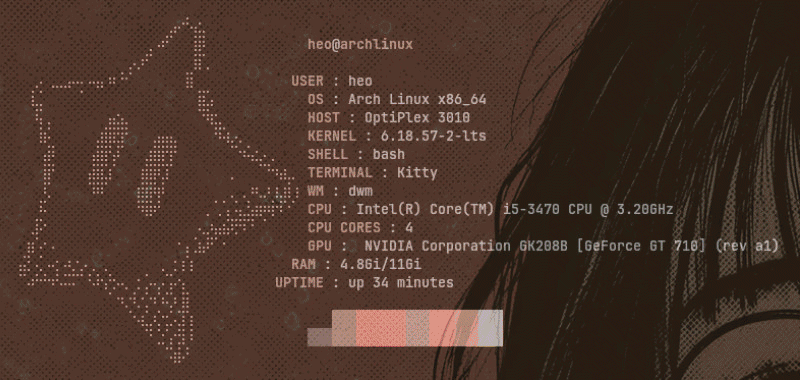

<p align=center> </p>

# <p align=center>JustFetch

<p align=center>A lightweight Bash-based system information tool for Linux, built as my first shell scripting project.

<p align=center> </p>

<p align=center>JustFetch displays useful information about your system directly in the terminal, with custom colours and a few fun command-line options.

## Features

- Displays operating system information
- Shows kernel version and machine architecture
- Displays the current username
- Shows system uptime
- Displays used and total RAM
- Custom terminal colours
- Help and version options
- JSON output option
- Instagram link option
- Handles invalid command-line arguments

## Usage

Run JustFetch from your terminal:

```bash
justfetch
```

### Available options

| Option | Description |
| --- | --- |
| `--help` | Display help information |
| `--version` | Display the current version |
| `--json` | Display JSON output along with System Information for verifications |
| `--logoconfig` | Steps to add your own logo |
| `--logo` | Add your own logo |
| `--image` | Add your image to be displayed pixelated |
| `--follow` | Display my Instagram link |

Unsupported options display an error message.

## Requirements

### System Requirements

- **Operating System:** Linux
- **Shell:** Bash
- **System information:** `hostnamectl` (provided by systemd)
- **Standard utilities:** `uname`, `uptime`, `free`, `cut`, `awk`, and `lshw`
- **Hardware information:** `pciutils` (provides `lspci`)

### Dependencies

- **[ascii-image-converter](https://github.com/TheZoraiz/ascii-image-converter):** Required for converting custom images into ASCII logos.
- **[chafa](https://github.com/hpjansson/chafa):** Required for converting custom images into Pixelated logos.


### Installing Dependencies

Install the required packages using your distribution's package manager.

#### Arch Linux / Manjaro / EndeavourOS

```bash
sudo pacman -S bash systemd util-linux procps-ng coreutils gawk lshw pciutils
```
#### Debian / Ubuntu-based distributions

```bash
sudo apt update
sudo apt install bash systemd util-linux procps coreutils gawk lshw pciutils
```
#### Fedora

```bash
sudo dnf install bash systemd util-linux procps-ng coreutils gawk lshw pciutils
```
#### openSUSE

```bash
sudo zypper install bash systemd util-linux procps coreutils gawk lshw pciutils
```
### Installing ascii-image-converter

Follow the official installation instructions for your system:
- [Official installation guide](https://github.com/TheZoraiz/ascii-image-converter#installation)
- [Arch User Repository (AUR)](https://aur.archlinux.org/packages/ascii-image-converter-git)
- [Homebrew installation](https://github.com/TheZoraiz/ascii-image-converter)

#### Verify the installation with:

```bash
ascii-image-converter -h
```
### Installing chafa
- [Official installation guide](https://github.com/hpjansson/chafa#installing)


<sub>Note: Package names may vary between distributions. hostnamectl requires systemd, and custom logo conversion requires ascii-image-converter and chafa to be installed and available in your PATH.</sub>


## Installation

Clone this repository:

```bash
git clone https://github.com/SriHariHaran-T/justfetch 
cd justfetch
```

Make the script executable:

```bash
chmod +x justfetch logo information
```
Create a symbolic link in `~/.local/bin` so you can run JustFetch from any directory:

```bash
mkdir -p ~/.local/bin
```
Copy the all the files from justfetch folder into your `~/.local/bin`

Ensure `~/.local/bin` is included in your PATH. If it isn't, add this line to your `~/.bashrc`:

```bash
export PATH="$HOME/.local/bin:$PATH"
```
Reload your Bash configuration:

```bash
source ~/.bashrc
```
Run it:

```bash
justfetch
```

## Why I built this

justfetch started as a small project to practise Bash scripting on Arch Linux. While building it, I explored variables, command substitution, functions, conditionals, ANSI colours, command-line arguments, pipes, `awk`, and exit codes.

This project is a work in progress, and I plan to improve it as I continue learning Linux and shell scripting.

## Author

**Sri Hari Haran T**

- Instagram: [@heodoestech](https://www.instagram.com/heodoestech/)

## License

This project is licensed under the MIT License.
See the [LICENSE](LICENSE) file for details.
